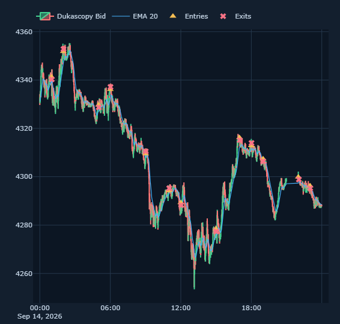

# Screenshot and chart evidence

`dukascopy-xauusd-m1-backtest.png` is a PNG exported by the Strategy Lab's Plotly chart using the Download plot as a PNG control in the ChatGPT in-app browser. It shows Dukascopy XAUUSD M1 for 2026-09-14, EMA 20, entry markers and exit markers. It is a chart export, not a screenshot of the entire application viewport.

The UI itself was also visually checked in the browser: dataset source banner, run selection, trade metrics/table, replay controls, and selected-candle inspector. The CUA connector did not expose a supported project path for saving a full-viewport screenshot.

Reproducible data and run evidence: `../test_outputs/final_audit_summary.json` and `../../strategy_lab/runs/85808ac8-84eb-478e-a405-7ba41a11f56d/`.

Continuation update 2026-11-06: replay cursor movement was visibly checked in the ChatGPT in-app browser; Inspector followed 00:00 → 00:01 → 00:00. A full-app screenshot was captured in browser memory but could not be saved through a supported project-file mechanism; browser policy refused data-URL navigation. Existing chart PNG exports are unchanged.
